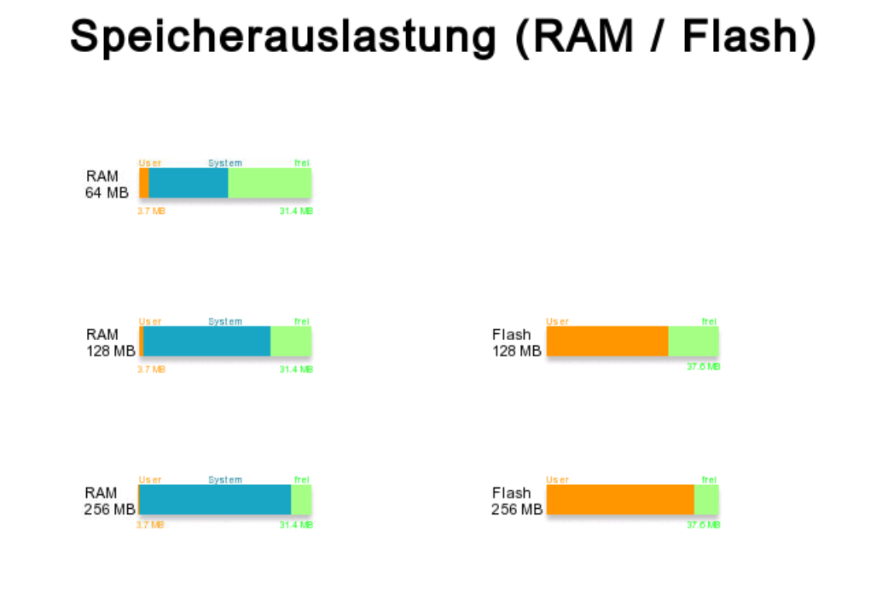

# Kostenlose Kinco-DTools-Komponenten von spstiger

Eine Bibliothek fertiger Komponenten für **Kinco DTools V4** (MK-, GT-, GL- und G-Serie),
die ihr per Rechtsklick in eure HMI-Projekte einfügen könnt.



## Enthaltene Komponenten

| Komponente | Zweck | Doku |
|---|---|---|
| `ram_64`, `ram_128`, `ram_256` | RAM-Auslastung (Benutzer / System / frei) für 64, 128 oder 256 MB | [Speicheranzeige](docs/speicheranzeige.md) |
| `flash_128`, `flash_256` | Freier Flash-Speicher für 128 oder 256 MB | [Speicheranzeige](docs/speicheranzeige.md) |
| `brightness` | Display-Helligkeit per Schieberegler und Tasten | – |
| `spstiger Logo` | spstiger-Logo als Bild | – |
| `screen_saver_logo` | Bewegtes Logo für einen Bildschirmschoner (Moving + Timer) | – |

Aktuelle Version: siehe [VERSION](VERSION), Änderungen im [CHANGELOG](CHANGELOG.md).

## Installieren und aktualisieren

**Empfohlen – Update-Skript (ohne Git):**

1. Unter [Releases](https://github.com/spstiger/Kinco-HMI-DTools-free-spstiger-components/releases/latest)
   die Datei **`spstiger-Bibliothek-Updater.zip`** herunterladen und entpacken.
2. DTools schließen, dann **`spstiger-Bibliothek-aktualisieren.cmd`** doppelklicken.
3. Das Skript installiert die neueste Version in **alle** DTools-V4-Installationen unter `C:\Kinco`
   und sichert die vorherige Fassung. Für spätere Updates einfach erneut starten.

Weitere Wege (ZIP von Hand, GitHub Desktop) und Hilfe bei Problemen: [docs/installation.md](docs/installation.md)

In DTools: Rechtsklick auf eine freie Fläche → **Eigene Komponenten → Eigene Komponenten nutzen** →
Bibliothek **spstiger-free-DTools-components** wählen.

> **Wichtig:** Komponenten, die schon in einem Projekt eingefügt sind, ändern sich durch ein Update
> nicht. Wer die neue Fassung möchte, fügt die Komponente neu ein.

## Aufbau des Repositorys

```
spstiger-free-DTools-components.pgl   Bibliothek ┐
vg/  image/                           Grafiken   ┘ = Inhalt des Release-ZIPs (Ordner für usrlib)
VERSION, CHANGELOG.md                 Version und Änderungen
beispiele/SpeicherauslastungHMI/      Beispielprojekt (MK070E) mit allen Speicheranzeigen
docs/                                 Anleitungen und Screenshots
tools/                                Update-Skript für Kunden, Build-Skript für Releases
.github/workflows/release.yml         Prüfung bei jedem Push, Release bei Tag vX.Y.Z
```

Die Bibliothek liegt bewusst im Hauptverzeichnis: So funktioniert auch ein Git-Klon direkt im
`usrlib`-Ordner von DTools weiter.

## Weitere Anleitungen

- [Speicheranzeige RAM/Flash – Aufbau und Systemregister](docs/speicheranzeige.md)
- [Eigene Komponentenbibliothek erstellen, exportieren, importieren](docs/eigene-bibliothek.md)
- [Neue Version veröffentlichen (für spstiger)](docs/release.md)

---

Fragen, Wünsche für neue Komponenten oder Hilfe bei eurem Kinco-HMI-Projekt:
[spstiger.de](https://www.spstiger.de) – wir sind Kinco-Distributor und unterstützen bei Auswahl,
Projektierung und Inbetriebnahme.
