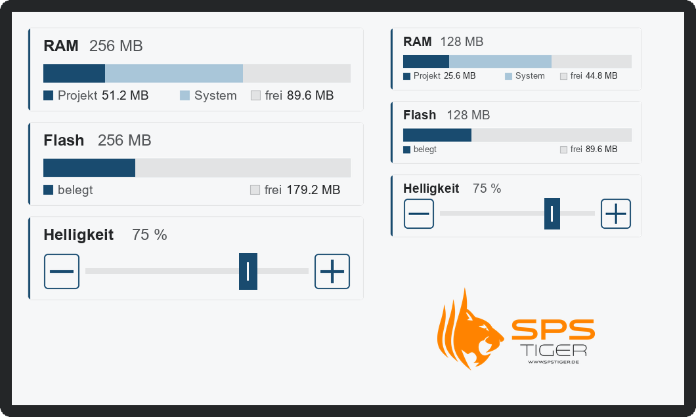
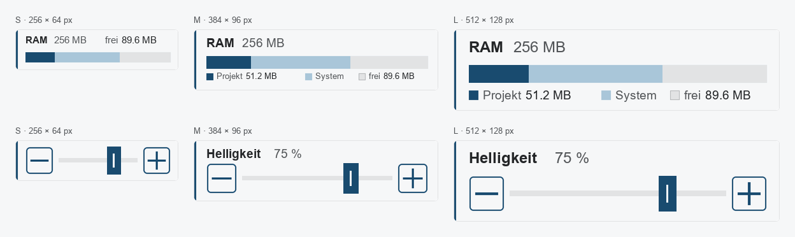

# Kostenlose Kinco-DTools-Komponenten von spstiger

Fertige Komponenten für **Kinco DTools V4** (MK-, GT-, GL- und G-Serie): Speicheranzeigen für RAM und
Flash, Helligkeitsregler und spstiger-Logos. Ihr fügt sie per Rechtsklick in eure HMI-Projekte ein,
jede in drei Größen.



## Drei Größen

Für jedes Panel die passende Größe: **S** für Statuszeilen, **M** für normale Bilder, **L** für
Diagnoseseiten und große Displays.



## Enthaltene Komponenten

Jede Komponente gibt es mit Endung `_S` (256 × 64 px), `_M` (384 × 96 px) und `_L` (512 × 128 px).

| Komponente | Zeigt | Register |
|---|---|---|
| `ram_64_*`, `ram_128_*`, `ram_256_*` | RAM: Projekt, System und frei als Balken, Werte in MB | LW9136 (Projekt), LW9134 (frei) |
| `flash_128_*`, `flash_256_*` | Flash: belegt und frei | LW9036 (frei) |
| `brightness_*` | Display-Helligkeit mit − / Regler / +, ab M mit Prozentwert | LW9140 (0–32) |
| `spstiger_logo_*` | spstiger-Logo (S ohne Claim, M und L mit www.spstiger.de) | – |
| `screen_saver_logo_*` | Bewegter Tigerkopf für einen Bildschirmschoner | LW2000–LW2002 |

[Alle 24 Komponenten auf einen Blick](docs/bilder/komponenten-uebersicht.png)

**Die richtige Speichervariante wählen:** RAM und Flash eures Geräts stehen im Datenblatt. Ist die
Variante zu klein, zeigt die Anzeige `**.*`, z. B. `ram_64` auf einem Gerät mit 256 MB RAM.

**Warnung bei wenig Speicher:** Sind weniger als 10 % frei, färbt sich der freie Teil des Balkens
orange.

**Bildschirmschoner:** `screen_saver_logo_*` gehört in das Fenster *ScreenSaver* eures Projekts. Zwei
Timer lassen den Tigerkopf über LW2001/LW2002 hin- und herwandern (±200 px waagerecht, ±100 px
senkrecht). LW2000–LW2002 dürfen in eurem Projekt nicht anders belegt sein.

Details zu Aufbau und Registern: [docs/speicheranzeige.md](docs/speicheranzeige.md)

## Installieren und aktualisieren

**Empfohlen – Update-Skript (ohne Git):**

1. Unter [Releases](https://github.com/spstiger/Kinco-HMI-DTools-free-spstiger-components/releases/latest)
   die Datei **`spstiger-Bibliothek-Updater.zip`** herunterladen und entpacken.
2. DTools schließen, dann **`spstiger-Bibliothek-aktualisieren.cmd`** doppelklicken.
3. Das Skript installiert die neueste Version in **alle** DTools-V4-Installationen unter `C:\Kinco`
   und sichert die vorherige Fassung. Für spätere Updates einfach erneut starten – es holt selbst
   die neueste Version, der Updater muss nicht neu heruntergeladen werden.

Windows fragt beim Start nach, weil das Skript nicht signiert ist. Vermeiden lässt sich das, indem
man die ZIP vor dem Entpacken unter **Eigenschaften → Zulassen** freigibt
([Details](docs/installation.md#windows-warnung-herausgeber-konnte-nicht-verifiziert-werden)).

Weitere Wege (ZIP von Hand, GitHub Desktop) und Hilfe bei Problemen: [docs/installation.md](docs/installation.md)

In DTools: Rechtsklick auf eine freie Fläche → **Eigene Komponenten → Eigene Komponenten nutzen** →
Bibliothek **spstiger-free-dtools-components** wählen.

> **Wichtig:** Komponenten, die schon in einem Projekt eingefügt sind, ändern sich durch ein Update
> nicht. Wer die neue Fassung möchte, fügt die Komponente neu ein. Das gilt auch für den Wechsel von
> Version 1 auf 2: Bestehende Projekte mit den alten Anzeigen laufen unverändert weiter.

## Aufbau des Repositorys

```
spstiger-free-DTools-components.pgl   Bibliothek ┐
vg/  image/                           Grafiken   ┘ = Inhalt des Release-ZIPs (Ordner für usrlib)
VERSION, CHANGELOG.md                 Version und Änderungen
tools/baue_bibliothek.py              erzeugt Bibliothek und Grafiken (Quelle des Designs)
tools/vorschau_bibliothek.py          Vorschaubilder aus der Bibliothek
tools/                                außerdem Update-Skript für Kunden, Build-Skript für Releases
beispiele/SpeicherauslastungHMI/      Beispielprojekt (MK070E, noch mit dem Design von Version 1)
docs/                                 Anleitungen und Bilder
.github/workflows/release.yml         Prüfung bei jedem Push, Release bei Tag vX.Y.Z
```

Die Bibliothek liegt bewusst im Hauptverzeichnis: So funktioniert auch ein Git-Klon direkt im
`usrlib`-Ordner von DTools.

## Weitere Anleitungen

- [Speicheranzeige RAM/Flash – Aufbau und Systemregister](docs/speicheranzeige.md)
- [Eigene Komponentenbibliothek erstellen, exportieren, importieren](docs/eigene-bibliothek.md)
- [Komponenten ändern und neue Version veröffentlichen (für spstiger)](docs/release.md)

## Lizenz

[MIT](LICENSE) – frei nutzbar, auch in kommerziellen Projekten, ohne Gewähr. Bei Weitergabe der
Bibliothek muss die Datei `LICENSE` beiliegen (im Release-ZIP ist sie enthalten).

---

Fragen, Wünsche für neue Komponenten oder Hilfe bei eurem Kinco-HMI-Projekt:
[spstiger.de](https://www.spstiger.de) – wir sind Kinco-Distributor und unterstützen bei Auswahl,
Projektierung und Inbetriebnahme.
