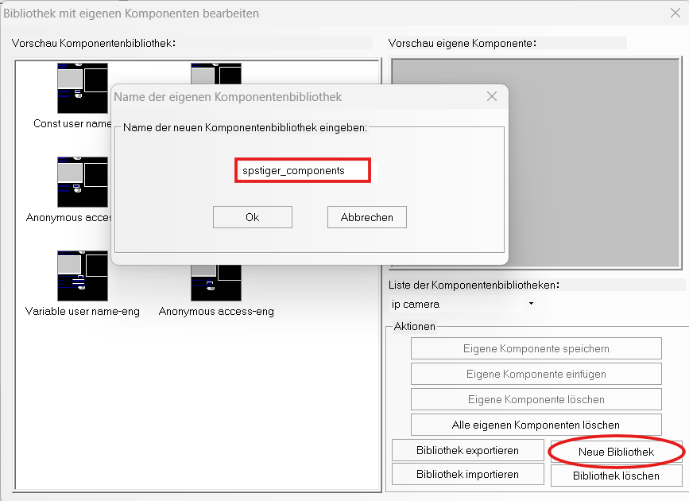
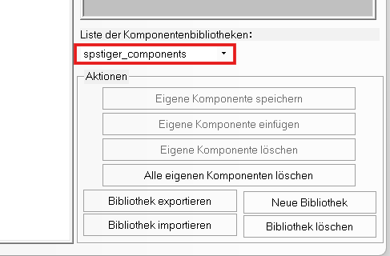
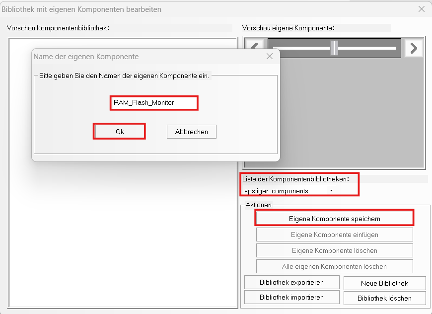
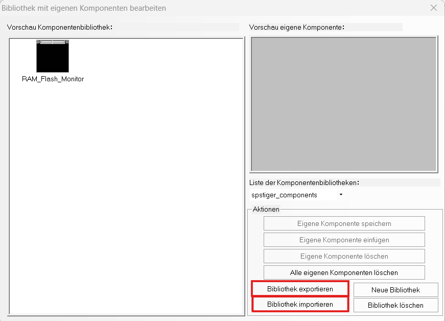
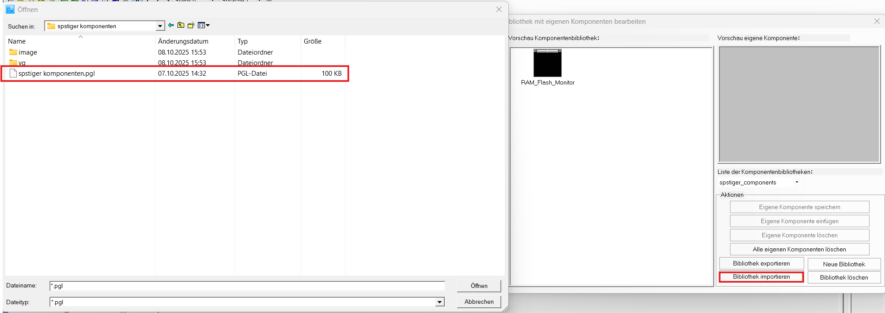

# Eigene Komponentenbibliothek erstellen und verwenden

DTools bringt eine **Standardbibliothek** mit, die man nicht verändern sollte. Eigene Elemente
(z. B. selbst gebaute Anzeigen) speichert man besser in einer **eigenen Bibliothek** – auch nicht in
der spstiger-Bibliothek, denn die wird bei jedem Update ersetzt.

## 1. Elemente vorbereiten und gruppieren

1. Alle zugehörigen Elemente (Balken, Zahlenanzeigen, Texte …) fertig aufbauen und ausrichten.
2. Alle markieren und mit **Strg + G** oder Rechtsklick → **Gruppieren** zusammenfassen.

Nur gruppiert speichert DTools die Elemente als eine Komponente.

## 2. Eigene Bibliothek anlegen

1. Rechtsklick auf das gruppierte Element → **Eigene Komponenten → Eigene Komponenten speichern**.
2. Im Dialog unten **Neue Bibliothek** klicken.
3. Eindeutigen Namen eingeben (z. B. `firma_components`) und mit **OK** bestätigen.

## 3. Komponente speichern

Vor dem Speichern prüfen, dass in der **Liste der Komponentenbibliotheken** die eigene Bibliothek
ausgewählt ist – sonst landet die Komponente in der Standardbibliothek.

1. **Eigene Komponenten speichern** wählen.
2. Namen für die Komponente eingeben (z. B. `RAM_Flash_Monitor`) und mit **OK** bestätigen.

Pro Speichervorgang wird genau eine Komponente gespeichert.

## 4. Komponente verwenden

1. Rechtsklick auf eine freie Fläche → **Eigene Komponenten → Eigene Komponenten nutzen**.
2. Bibliothek in der Liste wählen.
3. Komponente anklicken und einfügen.

## 5. Bibliothek exportieren und importieren

So kommt eine Bibliothek auf einen anderen Rechner oder in eine andere DTools-Version.

**Exportieren:** **Eigene Komponenten → Bibliothek exportieren**, dann den Speicherort wählen.
DTools legt dort einen Ordner mit allen Dateien der Bibliothek an, darunter die `.pgl`-Datei.

**Importieren:** **Eigene Komponenten → Bibliothek importieren**, den exportierten Ordner öffnen und
darin die `.pgl`-Datei auswählen. Danach erscheint die Bibliothek in der Liste.

Alternativ den exportierten Ordner bei geschlossenem DTools direkt nach
`C:\Kinco\Kinco DTools V4.x.x\usrlib\` kopieren – so arbeitet auch das spstiger-Update-Skript.
