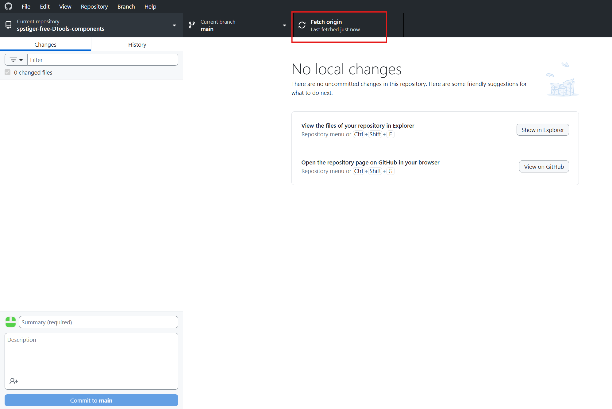
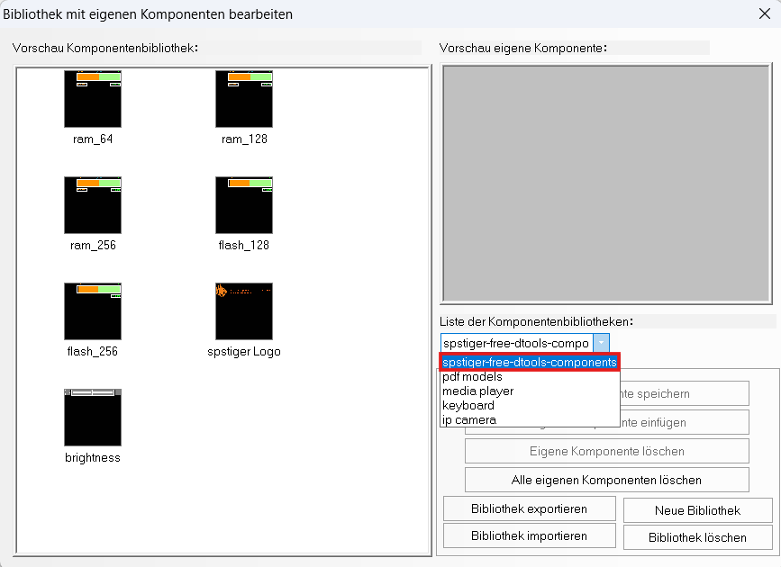

# Bibliothek installieren und aktualisieren

DTools V4 lädt eigene Bibliotheken aus dem Ordner `usrlib` der jeweiligen Installation, z. B.

```
C:\Kinco\Kinco DTools V4.4.0\usrlib\spstiger-free-DTools-components\
    spstiger-free-DTools-components.pgl
    vg\
    image\
```

Jede DTools-Version hat ihren eigenen `usrlib`-Ordner. Nach der Installation einer neuen DTools-Version
muss die Bibliothek dort also neu hinein – das Update-Skript erledigt das automatisch.

Den Ordner `usrlib` gibt Kinco vor: nicht verschieben oder umbenennen. DTools beim Installieren
immer schließen.

## Weg A – Update-Skript (empfohlen)

1. Unter [Releases](https://github.com/spstiger/Kinco-HMI-DTools-free-spstiger-components/releases/latest)
   **`spstiger-Bibliothek-Updater.zip`** herunterladen und an einen festen Ort entpacken
   (z. B. `Dokumente\spstiger`).
2. DTools schließen.
3. **`spstiger-Bibliothek-aktualisieren.cmd`** doppelklicken.

Das Skript

- lädt die neueste Version von GitHub,
- sucht alle Installationen `C:\Kinco\Kinco DTools V4*`,
- sichert eine vorhandene Fassung nach `%LOCALAPPDATA%\spstiger\DTools-Bibliothek\Sicherung`,
- ersetzt auch alte Kopien aus früheren ZIP-Downloads (z. B. Ordner `…-main`),
- lässt Ordner in Ruhe, die per Git oder Junction eingebunden sind (siehe Weg C).

Für spätere Updates das Skript einfach erneut starten. Ist schon alles aktuell, ändert es nichts.

Optionen (an die `.cmd` anhängen oder in PowerShell an `Update-spstigerBibliothek.ps1`):

| Option | Wirkung |
|---|---|
| `-NurPruefen` | Nur anzeigen, was installiert ist und was passieren würde |
| `-KincoOrdner "D:\Kinco"` | DTools ist nicht unter `C:\Kinco` installiert |
| `-Quelle "C:\Downloads\spstiger-free-DTools-components.zip"` | ZIP-Datei von Hand statt Download (z. B. ohne Internet am Rechner) |
| `-Erzwingen` | Auch bei gleicher Version neu installieren |

## Weg B – ZIP von Hand

1. Unter [Releases](https://github.com/spstiger/Kinco-HMI-DTools-free-spstiger-components/releases/latest)
   **`spstiger-free-DTools-components.zip`** herunterladen.
2. DTools schließen.
3. Den Ordner `spstiger-free-DTools-components` aus der ZIP nach
   `C:\Kinco\Kinco DTools V4.x.x\usrlib\` kopieren. Eine ältere Fassung vorher löschen –
   sonst erscheint die Bibliothek doppelt.

Die installierte Version steht in der Datei `VERSION` im Bibliotheksordner.

## Weg C – GitHub Desktop (für Entwickler)

Wer selbst Komponenten beisteuert oder immer den neuesten Stand von `main` möchte:

1. In GitHub Desktop **File → Clone repository** →
   `spstiger/Kinco-HMI-DTools-free-spstiger-components`.
2. Als lokalen Pfad direkt den `usrlib`-Ordner wählen, z. B.
   `C:\Kinco\Kinco DTools V4.4.0\usrlib\`.
   Alternativ woanders klonen und per Junction einbinden (Eingabeaufforderung als Administrator):
   ```
   mklink /J "C:\Kinco\Kinco DTools V4.4.0\usrlib\spstiger-free-DTools-components" "C:\Users\<Name>\Documents\GitHub\Kinco-HMI-DTools-free-spstiger-components"
   ```
3. Aktualisieren: DTools schließen, in GitHub Desktop **Fetch origin** bzw. **Pull origin**.



Der Klon enthält zusätzlich Beispielprojekt und Anleitungen; DTools ignoriert diese Ordner.

## In DTools prüfen

1. DTools starten.
2. Rechtsklick auf eine freie Fläche → **Eigene Komponenten → Eigene Komponenten nutzen**.
3. In der Liste der Komponentenbibliotheken **spstiger-free-dtools-components** wählen.



## Probleme

| Meldung / Verhalten | Abhilfe |
|---|---|
| „Kinco DTools ist geöffnet“ | DTools schließen, Skript erneut starten |
| „Keine Schreibrechte …“ | `.cmd` per Rechtsklick → **Als Administrator ausführen** |
| Skript startet nicht / wird blockiert | Die Firmen-IT erlaubt evtl. keine PowerShell-Skripte → Weg B |
| „Keine Installation … gefunden“ | DTools liegt nicht unter `C:\Kinco` → Option `-KincoOrdner` |
| Bibliothek erscheint doppelt | Alte Kopie (z. B. `…-main`) in `usrlib` löschen oder Skript laufen lassen |
| Kein Download möglich (Proxy/Firewall) | ZIP auf anderem Rechner laden, dann `-Quelle "<Pfad zur ZIP>"` |
| Eigene Komponenten in der spstiger-Bibliothek gespeichert | Das Update ersetzt den Ordner; die alte Fassung liegt in der Sicherung. Eigene Komponenten besser in einer eigenen Bibliothek speichern ([Anleitung](eigene-bibliothek.md)) |
