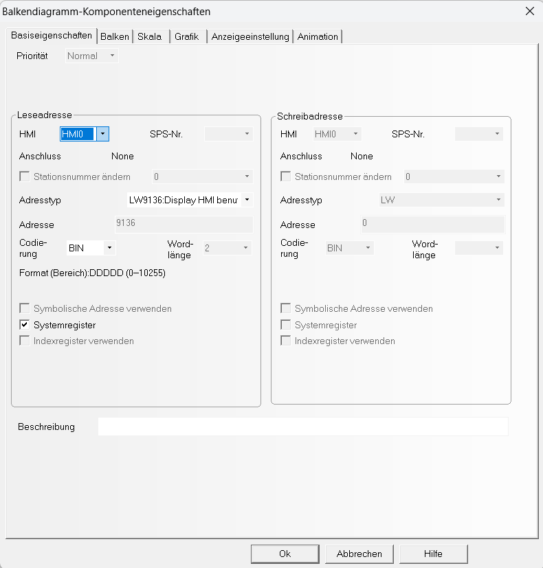
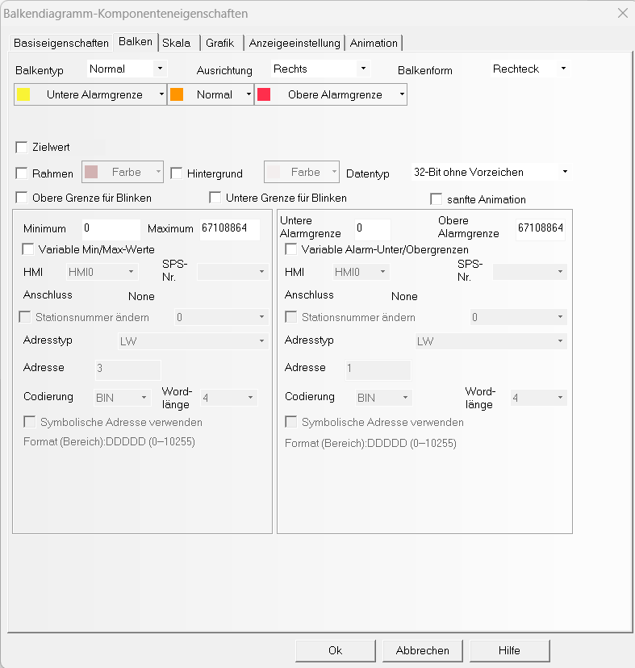
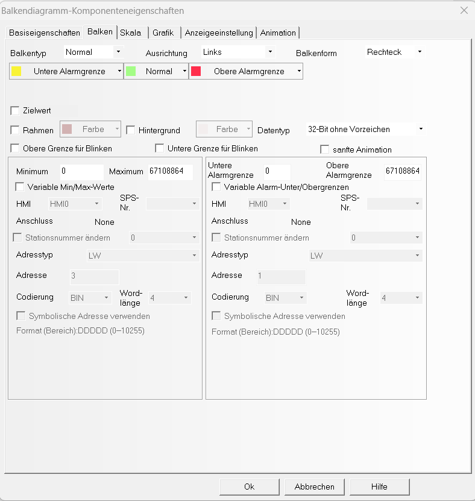
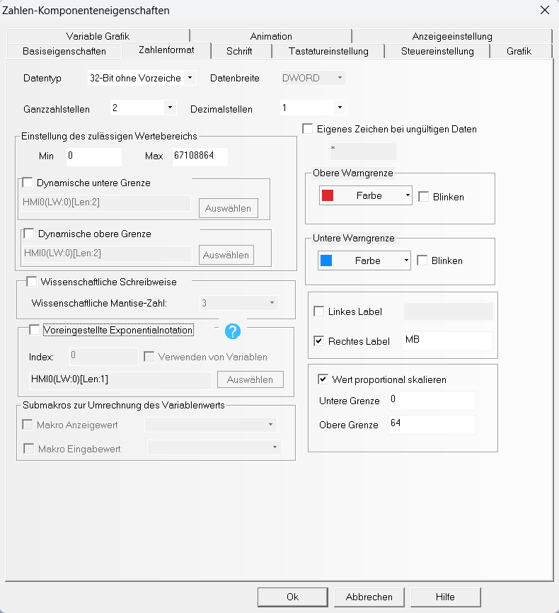

# Komponente Speicherauslastung (RAM / Flash)

Diese Komponenten zeigen die Speicherauslastung (RAM und Flash) eines Kinco-HMIs an.
Erstellt wurden sie auf einem **MK070E**; sie lassen sich auf andere Modelle übertragen.
Das komplette Beispielprojekt liegt unter [`beispiele/SpeicherauslastungHMI`](../beispiele/SpeicherauslastungHMI).

## Aufbau

Im **Fenster 0 (Hauptfenster)** des Beispiels stehen fünf Anzeigen für unterschiedliche Speichergrößen:

- **RAM:** 64 MB, 128 MB, 256 MB (`ram_64`, `ram_128`, `ram_256`)
- **Flash:** 128 MB, 256 MB (`flash_128`, `flash_256`)

Jede Anzeige zeigt grafisch, wie viel Speicher der Benutzer und das System belegen und wie viel frei ist.

## RAM-Anzeige

Beim Erstellen eines Projekts in DTools belegen **Bilder, Tabellen, Schriften und grafische
Komponenten** RAM. Das HMI lädt beim Start alle benötigten Ressourcen in den Arbeitsspeicher,
damit die Darstellung flüssig und die Reaktion schnell ist. Je mehr Grafiken oder große Bitmaps
ein Projekt nutzt, desto mehr RAM ist belegt – unabhängig von der Gerätegröße.

### Typische Speicherverbraucher

| Elementtyp | Beschreibung | Einfluss auf RAM |
|---|---|---|
| **Bilder / Bitmaps** | Hintergründe, Icons, Logos, Farbverläufe | hoch – werden vollständig in den RAM geladen |
| **Tabellen / Data Tables** | Datensätze wie Rezepte oder Parameterlisten | mittel bis hoch |
| **Schriften** | jede weitere Schrift oder Größe belegt Speicher | mittel |
| **Makros / Skripte** | Steuerlogik und interne Abläufe | gering bis mittel |
| **Balken, Zeigerinstrumente, Trends** | grafische Elemente mit Animation oder Aktualisierung | mittel |
| **Kommunikationsvariablen** | häufig aktualisierte Modbus-Register | gering, summiert sich bei vielen |

### Benutzter RAM (Benutzer)

Balkendiagramm und Zahlenanzeige lesen dasselbe Systemregister:

- **Systemregister:** LW9136
- **Datentyp:** 2 Words (32 Bit ohne Vorzeichen)
- **Ausrichtung:** rechts (Balken wächst nach links)
- **Wertebereich:** 0 bis RAM-Größe in Byte

| RAM-Größe | Maximalwert (Byte) |
|---|---|
| 64 MB | 67 108 864 |
| 128 MB | 134 217 728 |
| 256 MB | 268 435 456 |

### Freier RAM

- **Systemregister:** LW9134
- **Datentyp:** 2 Words (32 Bit ohne Vorzeichen)
- **Ausrichtung:** links (Balken wächst nach rechts)

Beide Balkendiagramme liegen **übereinander auf einer Bitmap**, die den vom System belegten Bereich
darstellt. So entsteht eine dreifarbige Anzeige:

- **Orange:** vom Benutzer belegter RAM
- **Blau:** vom System belegter RAM
- **Grün:** freier RAM

### Zahlenanzeigen in MB

Unter dem Diagramm zeigen Zahlenanzeigen LW9136 (belegt) und LW9134 (frei). Sie sind so skaliert,
dass sie Megabyte statt Byte anzeigen:

| Gerät | Unterer Wert | Oberer Wert |
|---|---|---|
| 64 MB | 0 | 64 |
| 128 MB | 0 | 128 |
| 256 MB | 0 | 256 |

Damit steht dort z. B. „27.4“ (MB frei) oder „12.8“ (MB belegt).

## Flash-Anzeige

Anders als beim RAM gibt es im Flash **keinen eigenen Systemanteil**: Betriebssystem und
HMI-Runtime nutzen den Flash im Betrieb nicht aktiv, sondern nur zum Speichern und Laden von Dateien.

- **Systemregister:** LW9036 (freier Flash)
- **Zahlenanzeige:** verbleibender Flash in MB
- **Balkendiagramm:** belegter Flash, auf einer Bitmap, die den gesamten Flash darstellt

Kinco-HMIs haben in der Regel 128 MB oder 256 MB Flash, darum gibt es zwei Varianten.

## Anpassen

- Die Adressen LW9134, LW9136 und LW9036 sind Systemregister und gelten in jedem Projekt.
- Farben lassen sich im Balkendiagramm-Editor ändern.
- Welche Speichergröße euer Gerät hat, steht im Datenblatt des HMIs.
